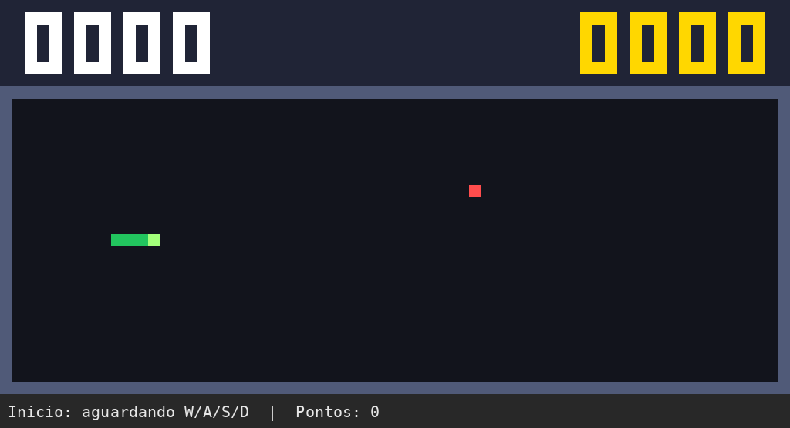
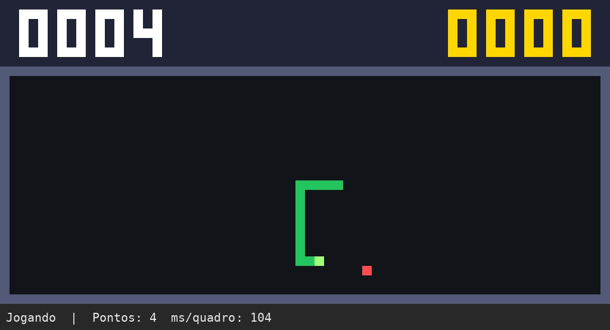
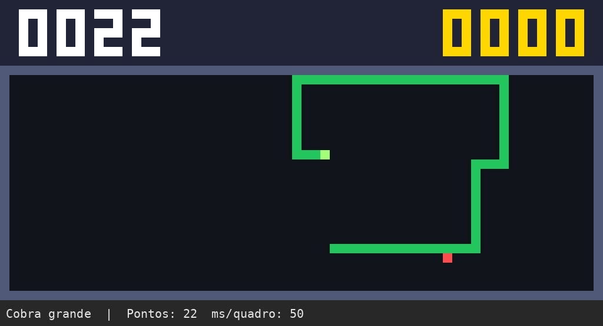
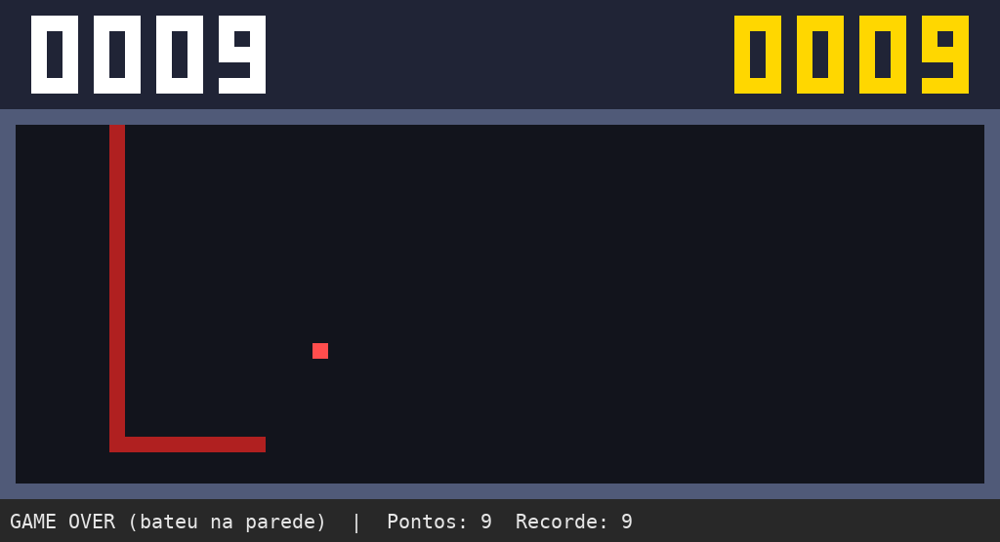
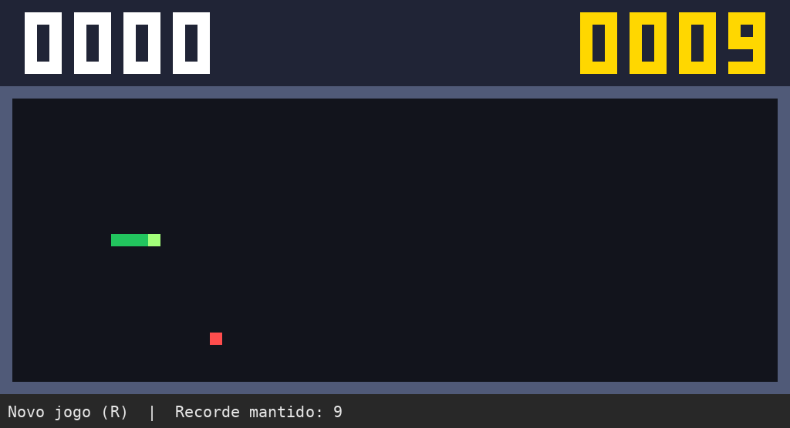

# Jogo da Cobrinha (Snake) em Assembly MIPS

Trabalho Final de **Arquitetura de Computadores II**. Tema: **1. Jogo da Cobrinha (Snake)**.
Ambiente: simulador **MARS 4.5** (Bitmap Display, Keyboard MMIO e Syscalls).

**Objetivos do tema e onde aparecem no código:**

| Objetivo | Onde |
|---|---|
| E/S mapeada em memória | Vídeo: escrita **e leitura** de pixels em `0x10040000`. Teclado: polling em `0xFFFF0000`/`0xFFFF0004` |
| Controle de taxa de atualização | Game loop com tempo de quadro fixo (syscalls 30 + 32), e o jogo acelera a cada comida |
| Manipulação dinâmica de arrays | Corpo da cobra num **buffer circular** que cresce e anda em O(1) |

## Telas

> Imagens simuladas por um modelo em Python com o mesmo layout, cores, fonte e lógica do `.asm`.
> Não são capturas do MARS.

| Início (aguardando W/A/S/D) | Jogando |
|---|---|
|  |  |

| Cobra grande (velocidade máxima) | Game over |
|---|---|
|  |  |

**Novo jogo com o recorde mantido** (canto superior direito, em dourado):



## Como executar

1. Abra o `cobrinha.asm` no MARS 4.5.
2. Abra **Tools → Bitmap Display** e configure:
   - Unit Width / Height in Pixels: **8** / **8**
   - Display Width / Height in Pixels: **512** / **256**
   - Base address for display: **0x10040000 (heap)**
   - Clique em **Connect to MIPS**
3. Abra **Tools → Keyboard and Display MMIO Simulator** e clique em **Connect to MIPS**.
4. **Run → Assemble** (F3) e depois **Run → Go** (F5). Deixe o *Run speed* no máximo.
5. Clique na caixa de baixo (**KEYBOARD**) do MMIO Simulator e jogue por ela.

## Controles

| Tecla | Ação |
|---|---|
| `W` `A` `S` `D` | Cima / esquerda / baixo / direita (a primeira tecla começa o jogo) |
| `P` | Pausar / continuar |
| `R` | Reiniciar (também funciona na tela de game over) |
| `Q` | Sair |

Cada comida vale 1 ponto, faz a cobra crescer 3 segmentos e deixa o jogo 4 ms mais rápido por
quadro (de 120 ms até no mínimo 50 ms). O placar fica em branco à esquerda e o recorde em dourado
à direita, desenhados no próprio Bitmap Display. O console *Run I/O* mostra os mesmos dados.

## Como o programa funciona

### Tela (64 × 32 unidades)
```
linhas 0..6   painel: placar e recorde (fonte 3x5)
linha 7 e 31  paredes
colunas 0, 63 paredes
área de jogo  colunas 1..62, linhas 8..30
```
Cada unidade é uma **word** de cor. A posição é `y*64 + x` e o endereço do pixel é
`0x10040000 + posição*4`. A multiplicação por 64 é feita com `sll 6`.

### Buffer circular (arrays dinâmicos)
O corpo é um vetor de 2048 *halfwords* (`corpo`) com as posições dos segmentos:

- `$s0` aponta a **cabeça** e `$s1` a **cauda**.
- **Andar:** grava a nova cabeça em `corpo[$s0+1]`, apaga o pixel da cauda e avança `$s1`.
- **Crescer:** igual, mas **sem** avançar a cauda (contador `$s3` de segmentos pendentes).
- A volta do índice é `andi $s0, $s0, 2047`, pois 2048 é potência de 2.

Assim cada quadro custa O(1), sem deslocar o vetor inteiro, qualquer que seja o tamanho da cobra.

### Colisão lendo a memória de vídeo
Em vez de manter uma matriz separada, o jogo **lê a cor** do pixel de destino:

| Cor lida | Significado |
|---|---|
| `COR_FUNDO` | casa livre, só anda |
| `COR_COMIDA` | come, cresce e acelera |
| qualquer outra | parede ou corpo, **game over** |

A cauda é apagada **antes** do teste. Por isso a cabeça pode entrar na casa que a cauda acabou
de liberar, como no jogo original.

### Taxa de quadros fixa
```
loop:
    t0 = tempo()                    syscall 30
    le_teclado()                    polling do MMIO (1 tecla por quadro)
    move_cobra()
    gasto = tempo() - t0
    se (quadro_ms - gasto) > 0:
        sleep(quadro_ms - gasto)    syscall 32
```
Usar só `sleep(quadro_ms)` deixaria o jogo mais lento em quadros com mais trabalho. Descontando
o tempo gasto, a velocidade fica constante.

### Registradores globais
| Reg. | Uso |
|---|---|
| `$s0` / `$s1` | índice da cabeça / cauda no buffer circular |
| `$s2` | direção como deslocamento: `+1`, `-1`, `+64`, `-64` |
| `$s3` | segmentos ainda a crescer |
| `$s4` | pontos |
| `$s5` | duração do quadro (ms) |
| `$s6` | pausado |
| `$s7` | tempo do início do quadro |

Guardar a direção como deslocamento faz o movimento virar uma soma (`nova = cabeça + $s2`).
O bloqueio de meia-volta vira uma comparação com `-$s2`.

### Sub-rotinas
| Rotina | Função |
|---|---|
| `inicia_jogo` | Desenha painel, paredes e fundo, cria a cobra e sorteia a comida |
| `move_cobra` | Anda, cresce, detecta colisão e come |
| `le_teclado` | Polling do teclado e tratamento da tecla |
| `sorteia_comida` | Posição aleatória livre (syscall 42) |
| `pinta_cobra_morta` | Percorre o buffer circular da cauda à cabeça pintando de vermelho |
| `desenha_placar` → `desenha_numero` → `desenha_digito` | Placar no Bitmap com fonte 3×5 (bits testados com `srlv`/`andi`), usando a pilha para salvar `$ra` e `$s0..$s2` |
| `imprime_placar` | Placar no console |

## Sugestão de divisão (4 integrantes)

| Integrante | Responsabilidade | Na apresentação |
|---|---|---|
| 1 | `move_cobra` + buffer circular | Explica o array dinâmico e o crescimento |
| 2 | `inicia_jogo`, colisão por leitura de pixel e Bitmap Display | Explica a E/S mapeada em memória de vídeo |
| 3 | Game loop, `le_teclado`, taxa de quadros | Explica o polling do MMIO e o controle de FPS |
| 4 | Placar (fonte 3×5, pilha), comida aleatória, console e testes | Faz a demonstração ao vivo |

## Roteiro de apresentação (~10 min)

1. **Demonstração** (3 min): jogar, comer algumas comidas (cresce e acelera), pausar, bater e
   mostrar o recorde e o reinício.
2. **E/S mapeada em memória** (2 min): endereços do Bitmap e do teclado, escrita e leitura de pixel.
3. **Buffer circular** (2 min): cabeça, cauda, `andi` com 2047, crescimento sem cópia.
4. **Taxa de quadros** (1,5 min): syscalls 30 e 32, aceleração progressiva.
5. **Placar na tela** (1 min): fonte 3×5 em bits, pilha nas chamadas aninhadas.
6. **Perguntas**.

## Ideias de extensão
- Obstáculos internos (basta pintar pixels com `COR_PAREDE`, e a colisão já funciona).
- Comida especial que vale mais pontos e some depois de um tempo.
- Bordas atravessáveis (sair por um lado e entrar pelo outro) em vez de paredes.
- Som ao comer e no game over com a syscall 31 (MIDI).
